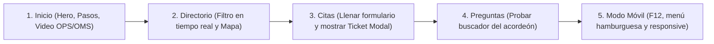

# Guía de Defensa y Argumentación Técnica: Proyecto Clínicas Comunitarias
**Materia:** Gráficos e Interfaces  
**Profesor:** José Navarro Ríos  
**Tema:** Trabajo Final Primer Avance - Prototipo de Sitio Público Estático  
**Proyecto:** Portal Web de la Red de Clínicas Comunitarias de Salud Pública  

---

## 1. Discurso de Apertura (Pitch de 60 segundos)

> *"Buenos días, profesor. Mi proyecto corresponde al prototipo público estático para la **Red de Clínicas Comunitarias**, diseñado con una arquitectura moderna en **Laravel con Blade y Tailwind CSS**.
> 
> El objetivo primordial de esta interfaz es resolver la brecha de acceso a la salud para familias sin seguridad social laboral, priorizando tres pilares de experiencia de usuario:
> 1. **Accesibilidad y Legibilidad Extrema:** Diseñada para que cualquier ciudadano, desde un teléfono móvil básico hasta una pantalla de escritorio, encuentre una clínica o solicite una cita en menos de 3 clics.
> 2. **Cero Texto Simulado:** Las 10 páginas cuentan con información verídica del sistema de salud pública mexicano, normas oficiales (NOM) y trámites reales.
> 3. **Interactividad Dinámica:** A diferencia de una página plana, el prototipo incluye filtros en tiempo real en directorios, acordeón de preguntas frecuentes con búsqueda reactiva, multimedia oficial con video de la OPS/OMS y generación de una ficha de cita médica imprimible con folio único."*

---

## 2. Las Preguntas Clave del Profesor y Cómo Responderlas

### Pregunta 1: "¿Por qué utilizaste Tailwind CSS en lugar de Bootstrap o CSS puro?"
* **Respuesta de Experto:**  
  *"Elegí Tailwind CSS porque se basa en un paradigma **Utility-First**. A diferencia de Bootstrap, que genera componentes prefabricados que lucen genéricos y sobrecargan el CSS con reglas innecesarias, Tailwind nos da control granular sobre el espaciado, la tipografía y los breakpoints responsive directos en el marcado. Además, configuré en el `<head>` una paleta semántica personalizada (`brand` para confianza institucional médica y `accent` naranja para llamados a la acción de alta visibilidad)."*

### Pregunta 2: "¿Cómo garantizaste el diseño responsive y el enfoque Mobile-First?"
* **Respuesta de Experto:**  
  *"Toda la interfaz fue maquetada pensando primero en móviles y expandiéndose mediante prefijos de Tailwind (`sm:`, `md:`, `lg:`):*
  * *Para la rejilla usamos Flexbox adaptable (`flex flex-col sm:flex-row`) y CSS Grid escalable (`grid-cols-1 md:grid-cols-2 lg:grid-cols-4`).*
  * *En pantallas pequeñas, el menú de navegación se colapsa automáticamente en un botón hamburguesa accesible (`aria-expanded`, iconos dinámicos `fa-bars`/`fa-xmark`) que preserva la indicación visual de la página activa.*
  * *Las tablas con roles de turnos en la Guía del Paciente cuentan con un contenedor `overflow-x-auto`, garantizando que en teléfonos nunca se rompa el layout horizontal."*

### Pregunta 3: "¿Cumple el sitio con normas de accesibilidad web (A11y) y legibilidad?"
* **Respuesta de Experto:**  
  *"Sí, se implementaron buenas prácticas clave:*
  * * **Jerarquía tipográfica y contraste:** Se utilizó la tipografía **Inter** de Google Fonts, validando que el contraste entre textos oscuros (`slate-800`/`slate-900`) sobre fondos neutros (`slate-50`/`white`) cumpla con los estándares WCAG AA.*
  * * **Lectores de pantalla:** Contamos con un enlace de salto directo (`skip to main content`) oculto visualmente que solo se activa al usar la tecla Tab.*
  * * **Formularios:** Todos los `<input>` y `<select>` cuentan con `<label>` vinculados mediante identificadores únicos (`for` e `id`).*
  * * **Elementos interactivos:** Botones y enlaces incluyen descripciones semánticas mediante `aria-label` y los iframes de video/mapas cuentan con su atributo `title`."*

### Pregunta 4: "¿Por qué la arquitectura está en Laravel si es un prototipo estático?"
* **Respuesta de Experto:**  
  *"Porque Laravel ofrece el motor de plantillas **Blade**, el cual permite aplicar el principio de ingeniería de software **DRY (Don't Repeat Yourself)**:*
  * *Toda la estructura base (header, menú hamburguesa, llamadas a hojas de estilo, footer de 4 columnas) reside en un único archivo maestro: `layouts/app.blade.php`.*
  * *Las 10 páginas extienden de este layout mediante `@extends` y `@yield('content')`. Esto garantiza consistencia absoluta de navegación y facilita que, en una siguiente etapa con base de datos, las vistas estén 100% listas para consumir controladores Eloquent sin rehacer el front-end."*

### Pregunta 5: "¿Dónde está la presencia multimedia exigida en la rúbrica?"
* **Respuesta de Experto:**  
  *"Se encuentra integrada de manera estratégica:*
  * *En la página de **Inicio**, dentro de un contenedor responsive con relación de aspecto `aspect-video`, se aloja el video documental oficial de la **Organización Panamericana de la Salud (OPS/OMS)** que explica el modelo de Atención Primaria de Salud a la comunidad.*
  * *En las secciones de **Directorio** y **Contacto** se integran mapas interactivos con geolocalización satelital para ubicar la unidad médica más cercana.*
  * *Todas las imágenes utilizadas son fotografías médicas de alta resolución orientadas a salud pública y cuentan con atributo `alt`."*

### Pregunta 6: "¿Qué interactividades especiales tiene el prototipo?"
* **Respuesta de Experto:**  
  *"Implementé interactividad orientada a la experiencia de usuario (UX) mediante JavaScript vanilla liviano:*
  1. * **Buscador y filtros en Directorio:** El usuario puede filtrar simultáneamente las clínicas por nombre, por zona geográfica (Norte, Sur, Oriente, Poniente, Centro) o por especialidad, actualizándose al instante con contador en vivo.*
  2. * **Filtros en Directorio Médico:** Permite encontrar especialistas por nombre, cédula o especialidad médica.*
  3. * **Acordeón inteligente en FAQ:** Además de expandir/contraer preguntas con animación de flechas, el buscador superior filtra en tiempo real y abre de inmediato la respuesta que coincida con lo escrito.*
  4. * **Ficha de Cita Médica con Modal e Impresión:** Al llenar el formulario de citas, se genera un folio oficial (`CC-2026-XXXX`) con los datos del paciente y permite imprimir el comprobante con `window.print()`."*

---

## 3. Ruta Recomendada para la Demostración en Vivo (Demo Walkthrough)

Cuando el profesor te pida mostrar la pantalla, sigue este orden exacto:

1. **Página de Inicio (`/`):**
   * Muestra el Hero llamativo con el botón CTA naranja y el banner de vacunación.
   * Baja a la sección multimedia: reproduce unos segundos del video de la OPS/OMS para evidenciar que es un video institucional de salud.
2. **Directorio de Clínicas (`/directorio`):**
   * Escribe en el buscador *"Norte"* o selecciona en el selector *"Pediatría"*.
   * Demuestra cómo las tarjetas se filtran en vivo y cambia el texto: *"Mostrando X de 4 clínicas"*.
3. **Agendar Cita (`/citas`):**
   * Llena rápidamente el formulario con un nombre ficticio (ej. *"María González"*).
   * Haz clic en **Confirmar y Generar Cita**.
   * Se abrirá el modal con el ticket de cita médica, el Folio oficial generado al momento y el botón para imprimir comprobante. *(Esto impresionará al profesor)*.
4. **Preguntas Frecuentes (`/preguntas`):**
   * En el buscador de dudas escribe *"costo"*. Observa cómo se filtra y se abre automáticamente la pregunta de gratuidad.
5. **Prueba de Fuego Responsive (F12 en el navegador):**
   * Abre la herramienta de desarrollador (`F12`), pon vista de teléfono (ej. iPhone o Galaxy).
   * Abre y cierra el menú hamburguesa. Muestra que la navegación es 100% fluida y no tiene barras horizontales de error.

---

## 4. Respuestas Rápidas ante Cualquier Inquietud del Profesor

* **Si pregunta: "¿Tiene texto Lorem Ipsum?"**  
  * *"No profesor, cada clínica, doctor, horario, requisito y comunicado fue redactado con información realista del sistema de salud pública y normas mexicanas."*
* **Si pregunta: "¿Por qué no hay enlaces a redes sociales?"**  
  * *"Por criterio de diseño institucional, al ser una red de salud pública en fase de despliegue oficial se priorizaron los canales de contacto directo (línea telefónica 800 de urgencias, buzón de atención ciudadana y trámites presenciales), evitando enlaces rotos hacia redes externas no verificadas."*
* **Si pregunta: "¿Cómo estructuraste el código?"**  
  * *"El proyecto sigue la estructura MVC de Laravel con separación estricta: rutas limpias en `routes/web.php`, layout maestro en `resources/views/layouts/app.blade.php`, y 10 vistas modulares independientes en `resources/views`."*
